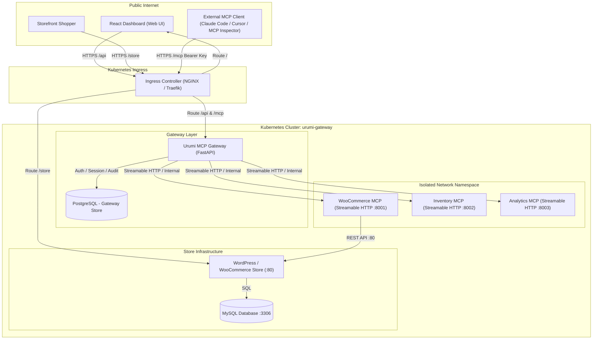

# Architecture Specification: Urumi AI — Team MCP Gateway

## Overview

Urumi AI is an enterprise-grade WooCommerce hosting and management platform powered by a centralized Team MCP (Model Context Protocol) Gateway running on Kubernetes. It provides unified, authenticated, and audited AI tool access to WooCommerce stores, warehouse inventory management systems, and revenue analytics engines.



---

## 4-Layer Architectural Separation

### Layer 1: Storefront & Dashboard
- **Storefront**: WordPress + WooCommerce hosting with Cash on Delivery (COD) enabled for local test purchases and order tracking.
- **Dashboard**: React 18 SPA built with TypeScript, Tailwind CSS, and Lucide icons. Provides interactive server administration, tool exploration, API key management, audit logging, and an AI chat interface.

### Layer 2: Core Team MCP Gateway
- Built on Python 3.12 and FastAPI.
- Acts as **MCP Client** towards internal upstream servers and **MCP Server** towards external clients and the internal AI agent.
- Enforces strict Role-Based Access Control (`ADMIN` vs `MEMBER`).
- Cryptographically validates user API keys (`umcp_...`) via SHA-256 hashes.
- Performs automatic collision handling and prefix namespacing (`<server_slug>__<tool_name>`).
- Redacts and sanitizes all payloads before persisting to `AuditLog`.
- Implements connection (3s) and request (15s) timeouts with failure isolation.
- Shields infrastructure using multi-tier SSRF protection.

### Layer 3: Upstream MCP Servers
- **WooCommerce MCP** (`:8001`): Interacts with WooCommerce REST API (`/wp-json/wc/v3/`). Exposes catalog and order lifecycle tools.
- **Inventory MCP** (`:8002`): Tracks warehouse SKUs, reserved stock, shelf locations, and low-stock warnings.
- **Analytics MCP** (`:8003`): Aggregates sales summaries, conversion rates, and top-selling product rankings.

### Layer 4: Storage Infrastructure
- **PostgreSQL**: Stores Gateway users, API keys, upstream server records, tool schemas, and audit logs.
- **MySQL & WP-Content**: Persistent volumes backing WooCommerce products, orders, and customer databases.

---

## Critical Invariant: Upstream Isolation

```
[ Browser / External Client ]
             │
             ▼
     [ Urumi Gateway ]  <── ONLY entity permitted to communicate with upstreams
       │      │      │
       ▼      ▼      ▼
    [Woo]  [Inv]  [Analytics]
```

**Architectural Rule**: The browser and external MCP clients MUST NEVER communicate directly with upstream MCP servers. Network policies in Kubernetes block all ingress to upstream MCP pods from outside the cluster namespace.
