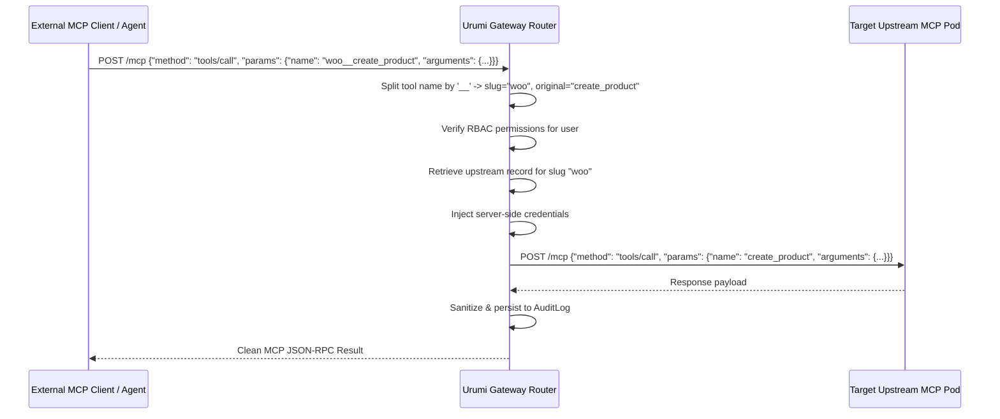
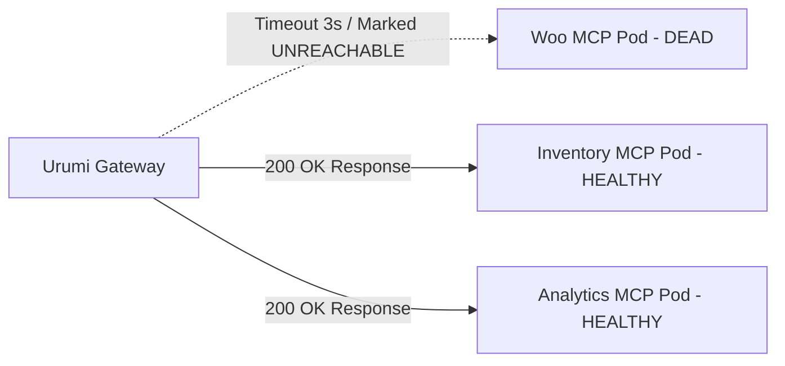

# System Design: Urumi AI Team MCP Gateway

## 1. System Responsibilities

| Component | Responsibility |
| :--- | :--- |
| **Gateway Core** | Reverse proxy, authentication, JWT issuing, user/API-key mapping, SSRF filtering. |
| **Tool Aggregator** | Discovers tools across all active upstreams, handles namespace collisions (`slug__tool`), synchronizes schemas. |
| **Security Vault** | Securely holds upstream credentials server-side; injects them during dispatch; redacts all secrets before logging. |
| **Audit Logger** | Records timestamped, structured audit events with duration, operator email, outcome, and sanitized inputs/outputs. |
| **AI Chat Agent** | Drives multi-turn tool loops under logged-in identity; handles multi-server correlation (WooCommerce + Inventory). |
| **Streamable MCP Endpoint** | Exposes `/mcp` (Streamable HTTP / JSON-RPC 2.0) compatible with Cursor, Claude Code, and MCP Inspector. |

---

## 2. Tool Aggregation & Collision Handling Strategy

### The Namespace Collision Problem
In multi-server architectures, multiple upstream MCP servers often expose identical tool names. For instance:
- WooCommerce MCP exposes `list_orders` or `get_orders`
- Warehouse Inventory MCP exposes `get_orders` (for procurement orders)
- Analytics MCP might expose `get_orders` (for cohort analysis)

If an external client queries tools without disambiguation, tools will overwrite each other.

### Disambiguation Invariant
Urumi solves this by enforcing a deterministic namespacing pattern:
```
<server_slug>__<tool_name>
```

#### Example Mapping:
- Upstream WooCommerce MCP (`slug: woo`) exposing `list_products` ➔ `woo__list_products`
- Upstream Inventory MCP (`slug: inventory`) exposing `list_inventory` ➔ `inventory__list_inventory`
- Upstream Analytics MCP (`slug: analytics`) exposing `get_sales_summary` ➔ `analytics__get_sales_summary`

#### Dispatch & De-aliasing Flow


---

## 3. Failure Isolation & Resiliency Matrix

A core requirement is that **the failure of one upstream server must never compromise the Gateway or other healthy upstream servers**.



### Resiliency Behaviors:
1. **Connection Timeout**: Configured by default to `3.0s`. If an upstream pod is restarting, unresponsive, or killed, the connection attempt aborts after 3 seconds.
2. **Request Timeout**: Configured by default to `15.0s`. If an upstream executes a long-running query that hangs, the Gateway times out and returns a structured error without leaking thread pools.
3. **Status Transitions**:
   - `CONNECTED`: Health check / tools list succeeds.
   - `UNREACHABLE`: Connection refused or timed out. Gateway continues serving requests from remaining connected servers.
   - `DISABLED`: Manually disabled by Administrator. Server's tools are immediately purged from discovery.
4. **Graceful Degraded Response**:
   When a client requests `woo__list_orders` while WooCommerce MCP is down:
   ```json
   {
     "jsonrpc": "2.0",
     "id": "req-1",
     "result": {
       "isError": true,
       "content": [
         {
           "type": "text",
           "text": "Upstream execution error: Upstream server 'WooCommerce Store' timed out after 15.0s"
         }
       ]
     }
   }
   ```
   An audit log record is created with `success = False` and the exact failure cause.

---

## 4. Multi-Server Correlation Architecture (Flow D)

The system handles operational queries spanning multiple domain boundaries.

### Prompt:
> *"Which products sold today are low in inventory?"*

### Execution Path:
1. **AI Chat Agent** analyzes request and identifies two information requirements:
   - Recent orders sold today (owned by WooCommerce MCP).
   - Real-time warehouse inventory and threshold flags (owned by Inventory MCP).
2. **Tool Execution 1**: Agent calls `woo__list_orders` via Gateway.
   - Gateway executes tool on WooCommerce MCP.
   - Returns line items from orders placed today (e.g. `KB-MECH-01`, `MS-WRLS-02`).
3. **Tool Execution 2**: Agent calls `inventory__list_inventory` via Gateway.
   - Gateway executes tool on Inventory MCP.
   - Returns inventory records with `is_low_stock` indicators.
4. **Correlation & Synthesis**:
   - Matches SKUs from sales data against inventory status.
   - Detects `MS-WRLS-02` (Wireless Ultra Mouse): sold in Order #5001 today, stock remaining = 8, below minimum threshold 15.
   - Produces synthesized executive recommendation to reorder stock.

---

## 5. Production Evolution & Tradeoffs (DNS, Ingress, StorageClass, Secrets)

The same umbrella Helm chart (`infrastructure/helm/urumi`) is designed to run locally on developer Kind/Minikube clusters and deploy to production-like VPS (k3s / managed K8s) via simple Helm values overrides:

| Dimension | Local Development (`values-local.yaml`) | Production VPS / k3s (`values-prod.yaml`) | Tradeoff / Rationale |
| :--- | :--- | :--- | :--- |
| **DNS Strategy** | `localhost` / `nip.io` or direct `kubectl port-forward` | Fully qualified domain names (e.g. `gateway.urumi.ai`, `store.urumi.ai`) | Local uses zero-config loopback; production uses public DNS A-records pointing to VPS public IP. |
| **Ingress Controller** | `ingress-nginx` or NodePort/port-forwarding | Built-in k3s `Traefik` with automatic TLS via `cert-manager` Let's Encrypt | Production terminates TLS at the ingress edge; local runs unencrypted HTTP for fast iterative debugging. |
| **StorageClass** | `standard` / `hostpath` / `local-path` | `local-path` (k3s default) or CSI block storage (`longhorn`, `ebs-sc`) | Local storage mounts host directories without persistent HA; production ensures stateful MySQL/PostgreSQL persistence across pod restarts. |
| **Secrets Management** | Plaintext values in `values.yaml` / mock default secrets | Injected at runtime via `--set secrets.postgresPassword=...`, sealed secrets, or external Vault | Avoids committing production secrets to git while keeping local dev zero-touch. |
| **Replica Scale** | 1 replica per service (minimal CPU/memory footprint) | 2–3 replicas for Gateway and Dashboard behind ClusterIP Services | Local fits comfortably within 4GB RAM limits; production provides zero-downtime rolling upgrades. |
| **SSRF Policy** | Relaxed mode allows `localhost` and `127.0.0.1` for mock servers | `SSRF_STRICT_MODE=true` rejects all loopback and unapproved private subnets | Prevents lateral movement or internal port scanning in production cluster. |

