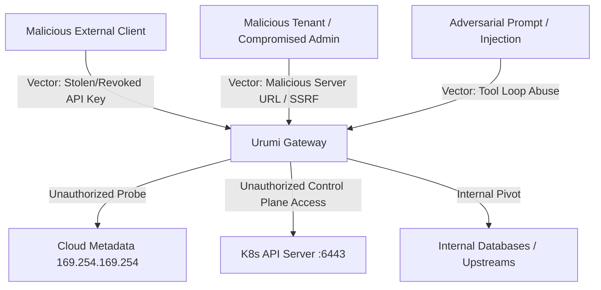

# Threat Model: Urumi AI Team MCP Gateway

## 1. Executive Summary

The Urumi AI Team MCP Gateway operates in a multi-tenant corporate environment aggregating tools from internal microservices (WooCommerce, Inventory, Analytics) and mediating AI agent actions. Because administrators can register arbitrary upstream MCP URLs and external AI clients execute operations, robust defense-in-depth is essential.

---

## 2. Attacker Profiles & Attack Vectors



| Threat Vector | Severity | Mitigated By |
| :--- | :--- | :--- |
| **Server-Side Request Forgery (SSRF)** | **Critical** | Multi-tier URL validation, blocked link-local/metadata IPs, internal host allowlisting. |
| **Upstream Credential Exfiltration** | **Critical** | Server-side credential injection, zero credentials returned to browser/clients, regex audit log sanitization. |
| **Compromised User API Key** | **High** | Instant revocation (`DELETE /api/keys/{id}`), SHA-256 storage (never plaintext), raw key shown once. |
| **Privilege Escalation** | **High** | Strict server-side RBAC checks on every endpoint, Member vs Admin segregation. |
| **Upstream Pod Denial of Service** | **High** | Connection timeouts (3s), request timeouts (15s), failure isolation (healthy upstreams remain online). |
| **Container Escape / Pod Takeover** | **High** | Non-root containers (`USER urumi: 1000`), dropped Linux capabilities (`drop: ALL`), read-only root filesystems where applicable. |
| **Network Snooping / Direct Access** | **High** | Kubernetes `NetworkPolicy` blocking external ingress to WooCommerce MCP, Inventory MCP, Analytics MCP, Postgres, and MySQL. |

---

## 3. Deep-Dive: Server-Side Request Forgery (SSRF) Protection

### The Vulnerability
Admins are permitted to register custom upstream MCP servers. Without strict controls, an attacker could register:
- `http://169.254.169.254/latest/meta-data/iam/security-credentials/` (AWS IAM role theft)
- `http://metadata.google.internal/computeMetadata/v1/instance/service-accounts/default/token` (GCP token theft)
- `https://kubernetes.default.svc/api/v1/secrets` (Cluster secrets compromise)
- `http://127.0.0.1:5432` (Probing database ports via SSRF)

### Multi-Tier Defense Pipeline

1. **Protocol Whitelisting**:
   - Only `http://` and `https://` schemes are permitted.
   - `file://`, `gopher://`, `ftp://`, `ldap://` are immediately rejected.

2. **Cloud Metadata Blacklist**:
   Explicitly checks against known cloud metadata endpoints:
   - `169.254.169.254`
   - `metadata.google.internal`
   - `100.100.100.200` (Alibaba Cloud)
   - `fd00:ec2::254` (AWS IPv6 metadata)

3. **Kubernetes Control Plane Protection**:
   - Blocks strings containing `kubernetes.default`, `kubernetes.default.svc`, and `:6443`.

4. **Internal Host Allowlisting**:
   - Upstream service hostnames must be explicitly declared in `SSRF_ALLOWED_INTERNAL_HOSTS` (e.g. `woo-mcp`, `inventory-mcp`, `analytics-mcp`).
   - Any unknown private IP (RFC 1918) or loopback is blocked in production `SSRF_STRICT_MODE=true`.

---

## 4. Upstream Credential Isolation

```
[ Client / Browser ] ───(API Key only)───> [ Gateway ] ───(Injected Secret)───> [ Upstream ]
```

1. **Never Returned Over API**:
   - When calling `GET /api/servers`, the `auth_credential` field is omitted from responses. Only a boolean `has_auth` flag is shown.
2. **Never Stored in Client Config**:
   - Cursor and Claude Code configurations need only the Gateway URL and user's `umcp_...` key. Upstream credentials are never shared.
3. **Redacted in Audit Logs**:
   - The Gateway's `sanitize_metadata()` function runs regex pattern replacement over all request and response bodies before saving to PostgreSQL.
   - Matches and redacts passwords, tokens, `ck_*` (WooCommerce consumer keys), `cs_*` (WooCommerce consumer secrets), and `umcp_*` API keys.

---

## 5. Network Isolation via Kubernetes NetworkPolicies

- Public Ingress reaches **only**:
  1. React Dashboard (`:8080`)
  2. WordPress Storefront (`:80`)
  3. MCP Gateway (`:8000`)
- **Internal Services** (`woo-mcp`, `inventory-mcp`, `analytics-mcp`, `postgres`, `mysql`) reject any packets whose source pod is not labelled `app.kubernetes.io/component: gateway`.
- Directly attempting to query `http://woo-mcp:8001/mcp` from outside the cluster drops packets at the Kubernetes CNI layer.
